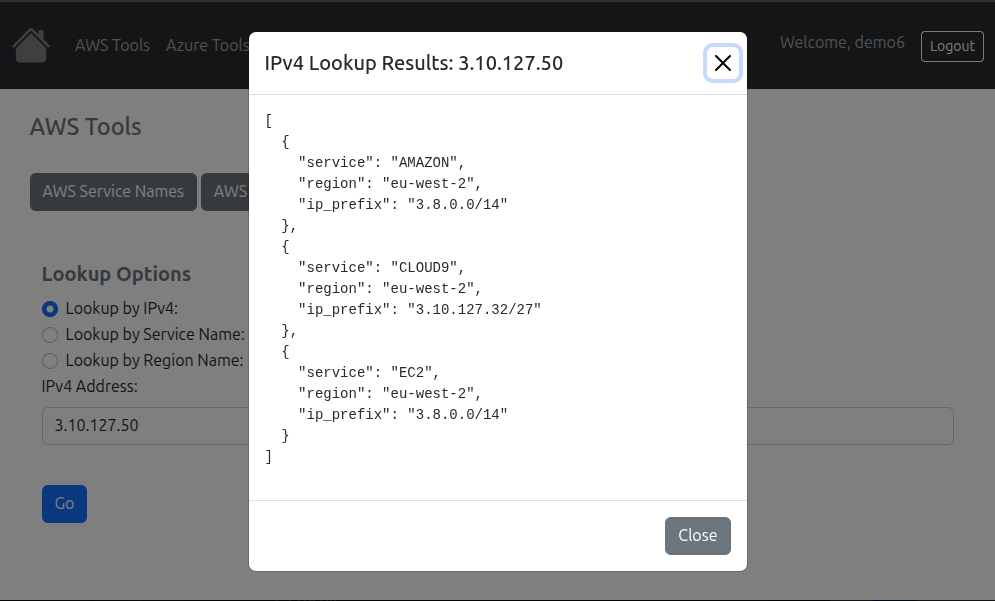
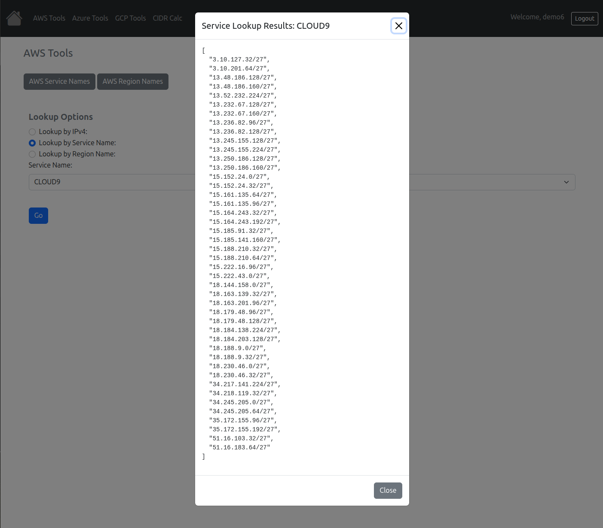
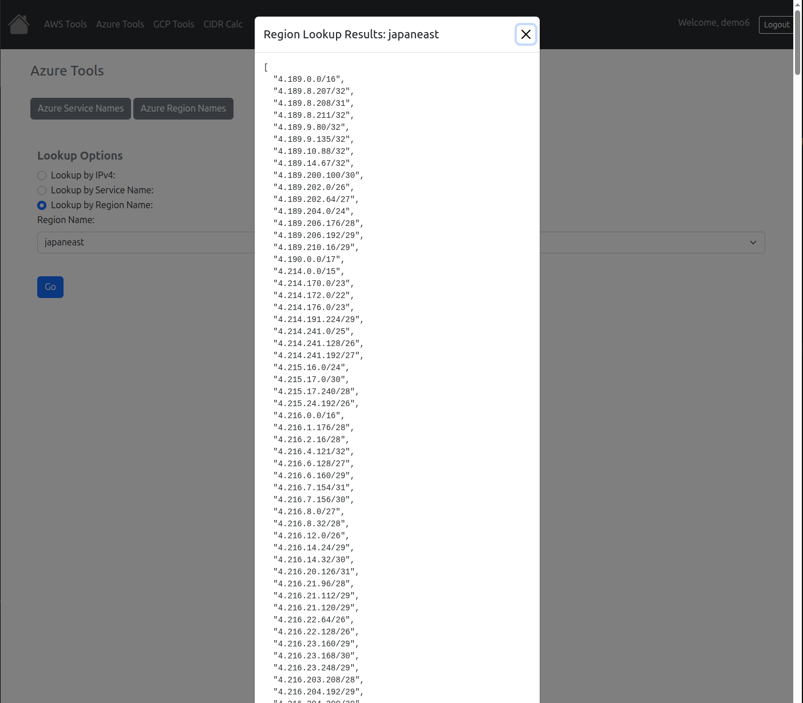
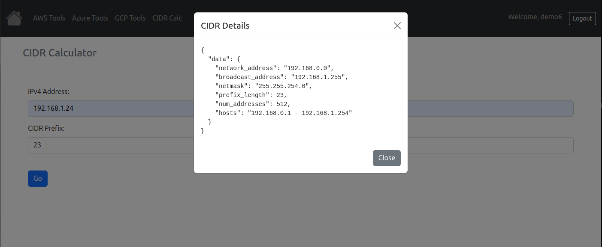

# Demo Tools for AWS, Azure, and Google Cloud IPv4 Prefixes



A web-based toolkit for exploring public cloud IPv4 address ranges.

This application helps identify cloud regions, services, and IPv4 prefixes published by AWS, Azure, and Google Cloud. It also includes an IPv4 CIDR calculator for subnet analysis and network planning.

Designed for network engineers, cloud engineers, and security analysts who need to quickly determine cloud IP ownership, validate firewall policies, and investigate network activity.

---

## About This Project

This project was created as a portfolio and demonstration application to showcase:

- Python development
- Django web application design
- Cloud networking knowledge
- Docker-based deployment
- Infrastructure automation concepts
- Software documentation and engineering practices

The idea for this application originated from a similar internal tool I developed several years ago to assist with cloud IP address identification and network troubleshooting. This version was rebuilt from scratch using modern technologies and deployment practices.

---

## Features

### Cloud IPv4 Lookup

Search an IPv4 address and determine:

- Cloud provider (AWS, Azure, or Google Cloud)
- Associated service
- Region
- Matching published prefix

### Prefix Browser

Explore provider prefixes by:

- Region
- Service
- Cloud provider

### IPv4 CIDR Calculator

Calculate:

- Network address
- Broadcast address
- Subnet mask
- Address count
- Usable host range

### Intelligent Caching

Provider prefix data is downloaded from public cloud feeds and cached locally to improve performance and reduce unnecessary external requests.

---

## Example Use Cases

### Security Investigation

Determine whether an observed IP address belongs to a cloud provider and identify the associated service and region.

### Firewall Policy Validation

Verify whether a network falls within an official AWS, Azure, or Google Cloud published range before building access-control policies.

### Network Planning

Use the CIDR calculator to validate subnet allocations, host counts, and addressing boundaries.

---

## Screenshots

### Cloud IPv4 Lookup



### Prefix Browser



### CIDR Calculator



---

## Technology Stack

| Component | Technology |
|------------|------------|
| Language | Python 3.13 |
| Framework | Django |
| Front End | Bootstrap 5 |
| Database | SQLite (default) |
| Web Server | Gunicorn |
| Reverse Proxy | Nginx |
| Static Files | WhiteNoise |
| Deployment | Docker Compose |

Cloud provider data is retrieved from publicly published AWS, Azure, and Google Cloud IP range feeds and cached locally within the application database.

---

## Quick Start

The fastest way to run the application locally.

The login page displays the demo credentials `demo` / `demo-secret6_!`. These
are intentionally public credentials for a non-privileged demo account. Use
them only with a disposable demo instance that contains no sensitive data; do
not reuse them for any personal or production account.

### 1. Create a Virtual Environment

```bash
python3.13 -m venv .venv
source .venv/bin/activate

python -m pip install --upgrade pip
python -m pip install -r requirements.txt
```

### 2. Configure Local Environment Variables

```bash
export DEBUG=True
export ALLOWED_HOSTS='127.0.0.1,localhost'
export SECRET_KEY='replace-with-a-local-development-secret'

export DEMO_USER_USERNAME='demo'
export DEMO_USER_PASSWORD='demo-secret6_!'
export DEMO_USER_EMAIL='demo@example.com'
```

### 3. Initialize the Database

```bash
python manage.py migrate
python manage.py ensure_demo_user
```

### 4. Start the Development Server

```bash
python manage.py runserver
```

### 5. Open the Application

Browse to:

```text
http://127.0.0.1:8000/
```

Log in using the demo credentials configured above.

`ensure_demo_user` creates the account only if the username does not already
exist. If you have an existing local database with a `demo` account, this
command does not reset its password; use `python manage.py changepassword demo`
to set it to the displayed demo password.

Provider lookups require outbound internet access to retrieve cloud provider prefix data.

---

## Running Tests

```bash
python manage.py test
```

---

## Project Structure

```text
.
├── app/
│   ├── settings.py
│   ├── urls.py
│   └── wsgi.py
├── demo/
│   ├── aws_utils/
│   ├── azure_utils/
│   ├── gcp_utils/
│   ├── ip_address_tools/
│   ├── management/commands/
│   ├── migrations/
│   ├── templates/
│   ├── tests.py
│   ├── urls.py
│   └── views.py
├── docs/images/
├── nginx/
├── static/
├── Dockerfile
├── compose.yaml
├── docker-entrypoint.sh
├── manage.py
├── requirements.txt
└── README.md
```

---

## Docker Deployment

The included Docker Compose deployment is intended for Linux hosts and can be used behind Cloudflare with Full (Strict) TLS enabled.

### Required Environment Variables

```bash
export SECRET_KEY='a-long-random-secret-value'

export ALLOWED_HOSTS='your-server-name.example.com'

export CSRF_TRUSTED_ORIGINS='https://your-server-name.example.com'

export DEMO_USER_USERNAME='demo'
export DEMO_USER_PASSWORD='demo-secret6_!'
export DEMO_USER_EMAIL='demo@example.com'
```

These values match the credentials displayed on the login page and are public.
Only use them for an isolated, non-privileged demo deployment. The startup
command does not change the password if this username already exists in the
persistent database.

If the existing account needs its password changed, run this after the web
container is running, then enter the new password when prompted:

```bash
docker compose exec web python manage.py changepassword demo
```

### TLS Certificate Requirements

Place the Cloudflare Origin CA certificate and private key on the host:

```text
/etc/ssl/cloudflare-origin/origin.pem
/etc/ssl/cloudflare-origin/origin.key
```

These files are mounted read-only into the Nginx container.

**Never commit certificates or private keys to source control.**

### Build and Start

```bash
docker compose up --build -d
```

### Useful Commands

View logs:

```bash
docker compose logs -f
```

Stop services:

```bash
docker compose down
```

Stop services and remove persistent volumes:

```bash
docker compose down --volumes
```

---

## Data Sources

This application uses publicly available cloud-provider IP range publications:

- Amazon Web Services (AWS)
- Microsoft Azure
- Google Cloud Platform (GCP)

Published provider data is cached locally to improve performance and reduce repeated external requests.

---

## Intended Audience
- Network Engineers
- Cloud Engineers
- Security Analysts
- Platform Engineers
- DevOps Teams
- Infrastructure Architects

---

## Future Enhancements

Potential future enhancements include:

- IPv6 support
- ASN lookups
- Prefix overlap analysis
- Export to CSV/JSON
- API endpoints for automation and integrations

---

## License

This project is licensed under the MIT License. See the LICENSE file for details.

## Third-Party Software

This project uses a number of open-source components, including Python, Django, Bootstrap, Gunicorn, Nginx, and other libraries listed in requirements.txt. These projects remain licensed under their respective licenses.